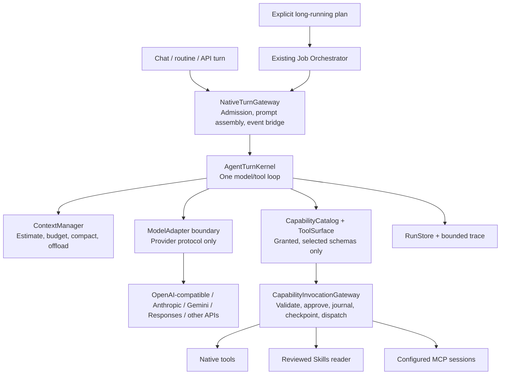

# MausClaw Native Engine — Single-Loop Modular Core (Design)

**Status:** Draft for owner approval. This document authorizes no implementation by itself.
**Date:** 2026-11-03
**Chosen approach:** Incrementally refactor the existing MausClaw engine into a small set of explicit modules. Keep one provider-neutral native turn loop, one context core, and MausClaw's capability/runtime contracts. No graph framework or external agent runtime is introduced.
**Owner decisions reflected here:** coding repositories and general 24/7 work are both in scope; one native loop and one context/budget core are mandatory; plugin expansion is out of scope for this design.

---

## 1. Executive summary

MausClaw already owns a useful native engine. The problem is not that it needs a clean-room replacement: it is that two model/tool loops and two context implementations coexist, responsibilities are concentrated in a large runtime function, and some good primitives are dormant or only partially wired. This design makes the existing native engine easier to reason about and safer to extend without replacing its contracts or platform.

The target is one `AgentTurnKernel` for every supported API provider. Provider adapters translate wire protocols; they do not own a model/tool loop. The kernel uses one context manager, one request/budget policy, and one capability invocation gateway. Native tools, Skills, and configured MCP servers enter through the existing capability lifecycle. The job orchestrator remains above the single-turn engine and is used only for explicit long-running plans.

The design's operating principle is **small, bounded, observable turns**: minimize and progressively disclose context; enforce grants and approvals at execution time; serialize effects; parallelize only known-safe independent reads; count every model request; never replay an operation whose outcome may be uncertain; and finish each run exactly once with an honest status.

This design does not claim MausClaw will outperform other agents. It defines how to measure progress under the same model, tasks, tools, grants, and prompt. `plan+verify`, orchestration defaults, subagents, and external benchmark spend remain gated and off until their evidence gates pass and the owner approves the next phase.

---

## 2. Audit findings that shape the design

### 2.1 Current execution paths

- `server/agent-runtime/runtime.ts` owns the MausClaw native `AgentEngine` loop, run status, adapter calls, compaction, capability dispatch, retry/failover, usage budgets, and event emission.
- `server/agent-runtime/native-turn-runtime.ts` is the product turn gateway and event bridge. When a turn is explicitly marked `mausclaw-native`, it calls `runNativeTurn()` and `AgentEngine.run()`. It also retains a second legacy model/tool loop for turns without that marker.
- `server/index.ts` sets `agentEngine: "mausclaw-native"` for the supported API drivers on normal product routes. However, direct adapter calls without the marker still reach the legacy loop; `native-provider-acceptance.test.ts` explicitly asserts this. The legacy path is therefore not globally unreachable.
- Native context currently uses `server/agent-runtime/compaction.ts` and `context-budget.ts`. The legacy loop separately uses `server/drivers/turn-context.ts` for request estimates, calibration, compaction, and output offload. Keeping two live turn loops also keeps two context policies alive.
- `AgentRunRequest` has token, cost, and wall-time budgets but no provider-instance identity or total-request budget. `ModelGenerateRequest` cannot explicitly express a no-tools final request. Those contracts need a small, versioned extension to support correct accounting.

### 2.2 Strong foundations to preserve

- One MausClaw-owned `AgentEngine` contract and replaceable `ModelAdapter`s.
- `CapabilityProvider`'s mount/list/validate/invoke/close lifecycle, run-scoped call journal, `uncertain_side_effect → recovery_required`, pre-mutation checkpoints, and rollback.
- SQLite-backed run, compaction, and tool-output records; model-aware tokenization, adaptive context-window learning, importance-scored compaction, and bounded tool-output reads.
- Existing per-bot Skills import/review flow: imported skills start disabled, protected manifests record hashes, and learned references are bounded and integrity-checked.
- Existing platform job runtime, approval gates, routines, multi-bot coordination, and session tree. These remain platform services, not a second single-turn engine.
- Existing fake-provider tests and tiered behavior-eval harness. Engine tests and platform behavior evals stay distinct.

### 2.3 Gaps to address or explicitly gate

- The model/tool loop and context logic are duplicated between the native and legacy product-turn branches.
- Native tool batches run concurrently only when the whole batch is read-only; mixed batches do not yet exploit safe read concurrency. There is no total request budget or cross-round repeated-call guard in the native loop.
- Native context uses a local tokenizer and provider usage observations, but does not yet apply a persistent provider-instance/model calibration to every size decision.
- `ToolSearchCapabilityProvider` searches names/descriptions, while the capability session still exposes the full MCP definition list to the model. It is not yet true progressive schema disclosure.
- MCP calls are conservatively classified as writes. That is safe but serializes even harmless reads. MCP-provided behavior annotations must remain hints, not authorization or safety policy.
- Capability composition needs a uniqueness invariant for IDs. Automatic fallback to another provider with the same capability ID is unsafe after a call may have dispatched.
- The existing plugin loader dynamically imports local code and its current registration path is not part of this design. Plugin behavior is not a supported target here; see §4.3 and §13.

### 2.4 Measured baseline (audit snapshot, 2026-11-03)

- MausClaw `server/agent-runtime`: 378/378 tests passed.
- MausClaw `server/runtime`: 266/305 passed; 38 failures and one non-passing case were reported in the audit. Most were stale fixtures/capability expectations; `level`/`envelope` drift was identified as real. Phase 0 must rerun and classify these results rather than assume the old classification still holds.
- RootClaw selected engine tests: 99/102 passed. Its 15-task suite scored 8/10 hard tasks on Ollama Cloud `beam`; this is a comparison baseline, not proof of superiority.
- These are historical measurements, not current verification claims.

---

## 3. Goals, non-goals, and constraints

### Goals

1. Route supported product turns through exactly one MausClaw-owned model/tool loop after parity is proven.
2. Use one context manager and one accounting policy for estimation, calibration, compaction, overflow recovery, and tool-output retrieval.
3. Make boundaries clear: gateway/admission, turn kernel, context, model adapter, capability catalog/execution, run store/trace, and job orchestration.
4. Make Skills, MCP, and built-in tools discoverable without sending every available schema on every request, while leaving grants and approvals enforced by the host.
5. Improve reliability without weakening recovery: no retries or fallback executions after a capability may have dispatched an effect.
6. Measure both coding and 24/7 behavior with repeatable local tests and version-pinned live benchmarks.
7. Preserve provider/model replaceability and the existing MausClaw platform.

### Non-goals

- Rewriting the platform, session/job runtime, provider adapters, or capability providers from scratch.
- Adding Claude Code/Codex/OpenCode/Hermes/Pi/Antigravity CLIs or ACP as runtime engines.
- Adding a third-party graph/agent framework as a runtime dependency.
- Building a plugin marketplace, a new plugin trust model, or a sandboxed plugin host in this design. Plugin expansion is deferred; existing plugin code is not represented as a supported capability path by the new kernel.
- Enabling plan+verify, automatic orchestration, subagents, or new memory by default.
- Running paid external benchmarks without a separate explicit owner approval.
- Claiming MausClaw is better than another engine without controlled head-to-head results.

### Constraints

- TypeScript/Node and the repository's existing provider-neutral contracts remain the implementation base.
- The model adapter is the only provider-protocol boundary. Context or tool policy must not depend on OpenAI Responses-only features.
- Every capability invocation must continue through grant/scope validation, safety-floor checks, approval policy, run journaling, and checkpoint/recovery behavior where applicable.
- Existing user data and plugin files are not migrated or deleted by this design.

---

## 4. Approaches considered

### A. Incrementally extract a modular turn kernel from the existing native engine — selected

Keep `AgentEngine`, `AgentRunRequest`, `ModelAdapter`, `CapabilitySession`, SQLite stores, and product event contracts. Extract cohesive modules around the current `runtime.ts` loop, then make the product gateway delegate all supported turns to that single loop. Retire the duplicate legacy loop only after the fake-provider and product-path parity gates pass.

**Why selected:** It addresses the actual cleanliness problem (duplicated loops and mixed responsibilities) while preserving MausClaw's tested safety, context, and platform behavior. The work can be staged and measured without adopting another runtime.

### B. Keep the large runtime and patch missing behaviors in place

Add calibration, request budgets, mixed tool scheduling, and discovery directly into the current `runtime.ts`; later redirect the legacy branch to it.

**Trade-off:** Lowest initial movement, but the central runtime remains harder to audit and future changes keep accumulating in one function. It meets “one loop” but not the desired clean module boundaries.

### C. Replace the loop with a graph/state-machine framework or a new graph runtime

Represent model, tool, verify, checkpoint, and resume as graph nodes.

**Trade-off:** Explicit transitions can help workflow recovery, but this duplicates the already-existing plan-DAG/job orchestrator and increases migration surface. A new framework also conflicts with the small native-core goal. The selected design uses explicit states and typed transitions inside MausClaw, not a general workflow graph runtime.

---

## 5. Target architecture

### 5.1 Module responsibilities

- **`NativeTurnGateway`** (the narrowed role of `native-turn-runtime.ts`): product admission, message/image preparation, capability-session construction, user approval bridge, steering, and event translation. It does not run a model/tool loop.
- **`AgentTurnKernel`** (extracted from `runtime.ts`): owns one explicit turn lifecycle, request/tool state transitions, budgets, retries, terminal status, and the loop that alternates model calls with validated tool execution.
- **`ContextManager`** (the single context/budget API): owns request estimates, provider-reconciled calibration, input/output headroom, one-pass compaction decisions, overflow recovery, pinned turn state, and tool-output paging. It builds on `compaction.ts`, `context-budget.ts`, and SQLite records; the legacy `drivers/turn-context.ts` must not remain a second live turn policy.
- **`ModelAdapter`**: translates MausClaw's canonical messages and tool surface to a provider protocol and maps response events/errors back. It does not retry on its own unless the retry is surfaced and charged to the kernel's request budget.
- **`CapabilityCatalog` / `ToolSurface`**: gathers descriptors for the current grant/profile and supplies the small initial set plus on-demand discovery results. Discovery never grants authority.
- **`CapabilityInvocationGateway`**: the single path from model proposal to execution. It revalidates identity and arguments, applies policy/approval and hooks, journals dispatch/settlement, creates checkpoints for mutations, runs the provider, and marks uncertain outcomes for recovery.
- **`RunStore` and trace**: persist run and capability state and bounded operational evidence. They do not persist hidden reasoning or secrets.
- **Existing job orchestrator**: schedules explicit multi-step work by calling the turn kernel. Normal chat does not become a DAG.

### 5.2 One loop and one context core are hard invariants

After the parity cutover:

1. All supported product turns, whether started by chat or by an explicit job step, use `AgentTurnKernel`.
2. The supported API drivers differ only through `ModelAdapter` and provider configuration.
3. Every model request, including summarization, overflow resend, retry, and optional verifier calls, passes through one request-accounting surface and consumes the same logical-turn request/token/cost/time ledger.
4. The legacy branch in `native-turn-runtime.ts` is not a second supported loop. It is either removed after call-site parity or retained only behind a temporary migration switch with an expiry/exit gate.
5. The context manager used before each generation request is the same for every adapter. Platform conversation/session summarization remains a separate platform concern and is not mistaken for per-request context budgeting.
6. Request/resource accounting belongs to the logical user-visible turn, not only an individual `AgentRunRecord`. Quick-model refusal retries and eligible automatic recovery attempts that replace a failed attempt share the same ledger. A new user message starts a new ledger; an orchestrated job also keeps its cumulative job budget and charges each child turn against it.

The adapter contract will be extended deliberately, not by leaking wire-format fields: `AgentRunRequest` needs the provider instance identity for calibration; the model request needs provider-neutral controls for disabling tools on the reserved final request and for bounding output tokens; request accounting must include every adapter generation call. Any adapter that cannot enforce no-tools at the wire layer is still protected by an empty advertised tool surface and host-side rejection of returned tool calls.

---

## 6. Turn lifecycle and smooth-loop behavior

The controller is a bounded state machine implemented in MausClaw code, not a general graph framework:

1. **Admit:** validate turn input, ensure the thread is not already running, create a run ID and run-scoped capability session, attach cancellation and budgets.
2. **Prepare:** select workload profile and granted tools, normalize messages, obtain model capabilities/context window, estimate the full request, and compact before sending if necessary.
3. **Request:** make one model call through the adapter; stream user-visible text once; count the request, usage, cost, and latency. If the stream fails after visible text, do not retry the call as though nothing was shown.
4. **Classify response:** a valid final answer advances to finalization; a tool batch must have unique IDs, valid names, and structured arguments; malformed, ungranted, or disabled tools fail closed.
5. **Authorize and dispatch:** check capability scope, deny rules, safety floor, approval, hook decision, and schema. If a hook changes arguments, validate and authorize the final arguments again. Record dispatch before invoking a side-effecting provider.
6. **Schedule safely:** consecutive independent calls with host-declared `parallelSafe`, `risk=read`, and `sideEffect=false` may execute in parallel (initial cap 4). If a provider derives a shared-resource concurrency key, calls with the same key serialize. Mutating, destructive, unknown-risk, or shared-state calls execute alone and in request order. Results are committed to the model transcript in original call order.
7. **Recover or continue:** bounded outputs are summarized/offloaded; the model sees a scoped `callId`/handle for paging. A known successful mutation advances the state epoch. Repeated identical reads may reuse a same-epoch result. A potentially repeated side effect is not silently re-executed; unknown outcomes transition to `recovery_required`.
8. **Finish exactly once:** close capability sessions and settle the run. Emit exactly one terminal completion/failure/interruption/recovery outcome. A stop, timeout, request cap, provider error, or hook denial must not leave the turn appearing successful.

The “smooth” bar is predictable progress: no duplicate deltas after retry, no mutation while a prior mutation is unsettled, no unbounded model/tool loop, stable result order, bounded concurrency, prompt cancellation between model rounds and tool batches, and an honest final answer when a budget is exhausted.

---

## 7. Context engineering

### 7.1 One estimator and calibration path

- Keep MausClaw's model-aware tokenizer and adaptive context-window learning as the baseline estimator.
- Reconcile estimates with provider-reported input usage using a bounded EMA/robust calibration keyed at least by `{instanceId, providerId, modelId}`. Two configured instances of the same model may account differently. Add a calibration version/expiry so changed adapters or provider behavior do not inherit stale ratios forever.
- Add `instanceId` to the internal run request (not to public model wire formats) and persist calibration through the existing store boundary where practical. Calibration is advisory; when unknown, use a conservative fallback and reserve headroom.
- Use adapter capability metadata for known context limits. Do not assume every model has the same context window from its display name.
- Count image/tool schema cost conservatively; where a provider-specific estimate is available, expose it through a narrow adapter estimator interface rather than branching on provider names inside the kernel.

### 7.2 Fit, compact, and recover

- Keep the current importance-aware compaction, bridge context, adaptive window, and background precompute, but expose them through the single `ContextManager`.
- Before each model request, reserve output tokens and safety margin; compact toward an empirically chosen target (initial experiment around 60% of input budget, not a permanent constant until evals support it).
- Compaction must preserve the system prefix, latest user request, complete assistant-tool/result groups, pinned plan when enabled, and salient error/finding lines. It may remove redundant old tool results while preserving a retrievable run-scoped reference.
- If summarization fails, use a deterministic fallback that keeps prior summary facts and representative heads/tails of folded messages. Never replace the conversation with an empty summary.
- A provider overflow may trigger one emergency shrink/compaction and one safe resend only when the rejected request did not yield visible output or dispatch a capability. The resend counts against request and cost budgets.
- Keep large tool output in SQLite `agent_tool_outputs`, show a concise head/tail preview, and expose paged reads through the existing run-scoped output capability. Apply per-run and total-store retention/size limits; handles must not read another run's output.

### 7.3 Context acceptance

- The long-context engine task preserves a buried error/finding after compaction.
- The actual provider input reported after a compacted request is within the configured input budget plus the documented estimator tolerance.
- A summarizer outage, provider overflow, or unreadable output does not cause silent loss of the previous summary or duplicate tool effects.
- Trivial turns with advanced features off make no extra model call.

---

## 8. Tools, Skills, and MCP

### 8.1 Capability identity, catalog, and invocation

Use the existing `CapabilityProvider`/`CapabilitySession` lifecycle, with these invariants:

- Capability IDs are unique for the whole run and source-qualified (for example, `native:<name>`, `mcp:<configured-server>/<tool>`, `skill:<name>`). Model-facing aliases may be provider-safe, but they map to exactly one stable capability ID.
- Duplicate IDs are rejected during session composition. The runtime must not select a provider by “first match” or cascade a failed potentially effectful call to another provider with the same ID.
- Tool discovery returns metadata only. It does not add grant, bypass `toolScope`, skip approval, or invoke the discovered tool.
- At every call, the invocation gateway checks the current grant, denies, safety floor, original full schema, and final post-hook arguments. Provider-side validation remains defense in depth.
- Unknown risk is treated as mutating for concurrency and retry. An external annotation alone never changes host authorization.
- All tool outputs are untrusted task data, not instructions or authority. The model may use the data, but it cannot derive new grants from tool output.

### 8.2 Progressive tool discovery

The current `tool_search` surface is not enough because the full MCP tool list is still sent to the model. Replace it with provider-neutral, client-side deferred disclosure:

1. Start with the selected profile's small common surface and a discovery capability for enabled/configured sources.
2. Search the configured MCP catalog and the enabled Skills metadata by namespace/name/description. Mount or list an MCP server only when discovery needs it, subject to a bounded startup deadline.
3. Return a short set of candidates. The kernel adds only the selected full schemas to the next model request; the selected schema is still filtered by the original grant and tool scope.
4. Revalidate the selected tool against its live provider before execution. A stale catalog or changed MCP tool list fails closed and refreshes discovery rather than calling a guessed tool.

This mimics the useful outcome of deferred tool search without relying on OpenAI Responses-only hosted `ToolSearchTool` behavior. Tool search and schema inclusion counts are traced so token savings and tool-selection regressions can be measured.

### 8.3 Skills

- Keep MausClaw's current import/review/integrity model: imported skills start disabled; only owner-enabled, hash-matching, protected revisions are visible to a bot.
- Use progressive disclosure: expose bounded `name`/`description` metadata; load the reviewed `SKILL.md` only when selected; load a bounded reviewed `references/<topic>.md` file only when the instructions call for it.
- Skills are instructional content, not executable tool plugins and not permission grants. `allowed-tools` in the Agent Skills format is experimental and cannot expand MausClaw grants or approval mode.
- Keep the current skill name/description index bound (30 skills/4 KB) and evaluate whether the per-skill tool descriptors should be replaced with one generic bounded reader. Make that choice from token and task-eval evidence, not by loading every skill body up front.
- Never auto-run scripts from a skill as part of loading the skill. Any script execution uses an already granted native/MCP tool with its normal safety and approval policy.

### 8.4 MCP

- Keep MCP as a transport/provider under MausClaw's capability session. Use configured server identity for namespacing, not server-supplied display names.
- Preserve current schema validation, per-turn session close, output/frame limits, timeouts, configured tool scope, approval broker, and control-plane environment stripping.
- Treat MCP tool descriptions, annotations, and result bodies as untrusted. `readOnlyHint`, `destructiveHint`, `idempotentHint`, and `openWorldHint` can inform UI/telemetry only when the server is trusted; they are not a security boundary.
- Until an owner-reviewed manifest provides a reliable local classification, an MCP tool is unknown-risk, effectful, serialized, and not safe for automatic replay. A future per-server policy may classify safe reads for bounded parallel execution.
- Keep sessions turn-scoped in the first rollout. Do not pool sessions across bots/users until credential-version, grant, cancellation, and isolation requirements have tests and a measured startup bottleneck.
- Consent to a local MCP server means consenting to execute its configured process. Show the exact command and server identity in the existing integration UX; run with least privilege where the platform allows it.

### 8.5 Plugins are out of scope

No new plugin API, marketplace, sandbox, or plugin-handler routing is part of this design. The kernel's capability catalog will cover built-in tools, reviewed Skills, and configured MCP only. Existing `plugin-loader.ts` behavior is not expanded or advertised as supported by the new kernel. Phase 0 inventories whether local plugin files are present and reports the existing dynamic-import/registration behavior; any change to that behavior requires a separate owner-approved design.

---

## 9. Tool orchestration, budgets, and reliability

### 9.1 Tool scheduler and repeated-call guard

- Parallelize only a consecutive group of independently safe reads. A descriptor must explicitly set host-owned `parallelSafe`; missing/false means serial. An explicitly parallel-safe provider may derive an optional per-call `concurrencyKey` for shared resources: matching keys serialize, different keys may run together, and no key means the provider declares the reads independent. Add this as an optional provider classifier or trusted host policy, not an MCP annotation. Initial concurrency is 4, configurable within a hard limit. Run mutating/destructive/unknown calls alone in request order.
- Commit all results in the model's original call order even if parallel reads finish in a different order.
- A repeated identical read may reuse its result only while no successful mutation invalidated the same state epoch.
- A repeated effectful call is not automatically cached or re-executed. If the descriptor explicitly supports an idempotency key, the provider must enforce it; otherwise the kernel asks for a state check or stops after a small configured repeat limit.
- Tests must cover mixed read/write/read order, abort in a batch, one slow read, duplicate IDs, same tool with reordered JSON keys, and one uncertain effect.

### 9.2 One request and resource budget

`AgentRunRequest` gains an optional `maxTurnRequests`. The counter increments on every model-adapter generation attempt: normal rounds, transport retries, failover attempts, context summaries, overflow resends, and optional verification. It is distinct from `modelRounds`, tool-call count, tokens, cost, and wall time. The gateway-owned ledger is shared with product-level replacement attempts such as `QuickModelFallback` and eligible automatic recovery, so starting a new internal run cannot reset the logical turn's cap.

When the last permitted request is used to produce a final response, it is sent with tools disabled. If there is no request left, the engine does not make a hidden extra call; it returns an explicit budget-exhausted/incomplete status and honest user-facing notice. No tools are dispatched after the budget is exhausted.

When a provider omits usage, input tokens fall back to the adapter estimator/local tokenizer and output tokens are counted from the returned stream. For a strict cost cap, reserve the next request's estimated input plus enforced maximum output against a versioned provider/model price table, then reconcile with reported usage. If the adapter cannot bound output or the price entry is missing, refuse the capped request before sending; an uncapped run may continue but reports cost as unknown. Never record missing usage as zero.

All per-turn limits are owned by a logical-turn budget ledger created at gateway admission and shared by internal run attempts. A turn cannot reset its budget by compaction, retry, model fallback, tool discovery, or verifier call. An orchestrated job additionally enforces a cumulative job budget across child turns. Profile defaults are tuned from eval traces; global ceilings remain enforced by the kernel.

### 9.3 Retry and failover

- Keep the current adapter error contract (`retryable`, `retrySafe`, `requestStarted`). One layer owns retry policy so adapter retries do not multiply invisibly.
- Initial HTTP policy may reuse the audited RootClaw schedule (four total attempts, approximately 1/3/8/8 s backoff with jitter; honor capped `Retry-After`; bounded total wait), but only for retry-safe model requests that have not produced visible output or dispatched a capability.
- Fail over only when the current response is not visible and no capability may have dispatched. Recompute context calibration for the destination adapter/model and charge the call to the same run budget.
- Never retry an uncertain capability operation. It is journaled `recovery_required`; a restart never replays it automatically.
- Checkpoint/rollback remains a safety tool for supported workspace mutations, not a claim that arbitrary external actions can be undone.

### 9.4 Hooks and approvals

Wire configured hooks only through the same invocation gateway. Hook-modified arguments are revalidated and the approval preview must match the final arguments. Hook timeout/failure is fail-closed for pre-tool policy. Hooks cannot widen the capability grant, remove safety-floor blocks, or cause a second dispatch. Hooks remain off unless configured and tested end-to-end.

---

## 10. Planning and 24/7 orchestration

- **Single-turn planning** may add the existing RootClaw-style `update_plan` and bounded self-check behind `engine.planVerify`. It remains off by default, has a maximum plan size, pins state outside compaction, and consumes the same request/token/cost budget. The verifier may request at most one repair by default; if still incomplete, the answer is marked unverified rather than hidden or silently retried forever.
- **Multi-step jobs** remain in MausClaw's existing plan-DAG orchestrator and job runtime. The orchestrator invokes normal `AgentTurnKernel` runs; it does not embed another model/tool loop. Ordinary chat does not route through the orchestrator.
- **24/7 recovery** is workflow-level: the job runtime records job/step state and the run journal records model/capability state. On restart, an unsettled external effect becomes `recovery_required`; a workflow can continue only after safe inspection or owner resolution.
- Subagents remain a later, separately gated feature. If approved in a future design, each child must get an isolated run ID, narrower grant, bounded context, cost/time/request budget, depth and concurrency caps, and parent cancellation.
- Intelligence/model routing remains optional and off until evals demonstrate better resolved-task cost/quality. Routing cannot change a turn's grants or safety policy.

---

## 11. Workload profiles

Both profiles use the same turn kernel. They differ by context, default capability surface, and budget policy—not by loop implementation.

| Profile | Default surface and policy | Explicitly not implied |
|---|---|---|
| `coding` | Workspace/file/shell/git tools when granted; lazy MCP/Skill discovery; context calibration and compaction; request/token/time budgets; bounded safe-read concurrency; verification available behind a flag | No automatic destructive access, no default plan+verify, no external CLI engine |
| `24/7` | Existing routines/jobs/multi-bot runtime; checkpoint and recovery; approvals; explicit plan-DAG for long work; cost/time/request budgets; bounded outputs and handoffs | No unbounded autonomous loop, no replay of uncertain effects, no implicit subagents |

The profile selection and grants are frozen in the eval manifest. A model's text cannot switch its run profile or widen its grant.

---

## 12. Trace, metrics, and eval protocol

### 12.1 Operational evidence

The run trace records bounded structured facts: run/profile/provider/model IDs, adapter call count, usage and cost when provided, estimated versus reported input tokens, compactions and output offloads, tool IDs and risk class, validation/approval results, execution durations, retry/failover reason, terminal state, and recovery state. Redact secrets and sensitive arguments. Do not persist hidden chain-of-thought as an observability requirement.

Report at least: resolve/pass rate, pass@1 and repeat consistency, cost per resolved task (or unknown with reason), p50/p95 turn and tool latency, input/output tokens, request/tool counts, compaction rate, timeout/retry rate, tool-selection errors, approval compliance, duplicate side effects, and recovery success.

### 12.2 Suites

1. **Deterministic native engine regression:** provider fixtures for loop boundaries, adapter normalization, stream termination, request budgets, compaction, dynamic tool selection, Skills, MCP errors, validation/approval, parallel read ordering, cancellation, failover, and recovery. No live API is required.
2. **Engine tasks:** port RootClaw's 15 tasks (10 hard) and runner as MausClaw-native tasks. Preserve task inputs/checks and record changes. The existing RootClaw 8/10 is a historical baseline; the adapted suite's baseline must be run before claiming parity.
3. **MausClaw platform behavior:** extend the existing hermetic/golden/live harness for routines, multi-bot, long research, restart recovery, budget caps, and approval interruptions. Check final state/invariants, not only transcript text.
4. **External coding benchmarks:** use SWE-Bench Pro as the primary public SWE-bench comparison when environment and budget permit; retain SWE-Bench Verified only as a historical/continuity reference with its contamination/test-quality limitations. Use the exact Terminal-Bench version and dataset revision pinned in each report (current target: 4.0). Do not run paid/full suites without explicit approval.

### 12.3 Comparison controls

For every head-to-head, pin the same model snapshot/provider, temperature/sampling, system prompt hash, tools/schemas, capability grants, workspace/container image, task dataset hash, output/request limits, and trial count. Keep MausClaw and RootClaw runs paired per task; report per-task outcome and uncertainty, not just aggregate accuracy. Use at least three trials during exploration and increase to ten for release claims or close comparisons; a small sample is not a superiority claim. Record all failures and all cost.

### 12.4 Gates

- No core feature is considered complete with failing or weakened tests. The known `server/runtime` failures must be individually fixed or explicitly documented and owner-approved before feature work depends on that suite.
- All supported product turns use the single kernel after cutover; an integration test fails if a second loop is reached.
- No duplicate effect across retry/restart tests; every dispatched ambiguous effect is `recovery_required`.
- Capability grant/safety-floor/approval tests pass for native tools and MCP; provider annotations cannot bypass them.
- Skills stay disabled until enabled/reviewed; loaded skill content cannot increase grants.
- Progressive tool discovery reduces offered schema/token count versus the current full-MCP surface without reducing task success beyond the report's uncertainty interval.
- With plan+verify off, no extra request or behavior change. With it on, enable only if held-out multi-step tasks improve enough to justify measured cost/latency overhead; default remains off until that gate passes.
- The 24/7 suite preserves all job-runtime invariants and restart-recovery rules.
- No superiority statement until the same-task/model/tool/prompt comparison passes the protocol above.

---

## 13. Phases and deliverables

### Phase 0 — Baseline and path inventory (no product feature changes)

- Freeze the baseline commit and rerun native-agent, runtime, eval, and relevant integration suites.
- Map every product call path into native and legacy turn loops. Inventory any `plugins/` content and document current loading behavior without expanding it.
- Classify runtime test failures from fresh output; repair fixtures/contracts without weakening safety assertions.
- Port the 15 engine tasks and report schema; run the deterministic suite and save a baseline report.
- Verify Docker availability and current benchmark image/task revisions, but do not start external paid benchmark runs.

**Exit:** the call-path map identifies every remaining legacy caller; baseline artifacts are reproducible; failures have owners/classifications; no external spend occurred.

### Phase 1 — Extract the single kernel and context boundary

- Extract the turn kernel and context manager from the current native loop while keeping the public `AgentEngine` contract stable where possible.
- Add the provider-instance identity and request controls required for calibration and no-tools final requests.
- Route normal product API turns and supported adapter calls to the same kernel. Keep a temporary legacy compatibility gate only while the parity test is active.
- Adapt legacy context helpers to call the shared context manager or remove their model-loop-only copies after reference search proves they are unused.

**Exit:** product-path acceptance tests and deterministic traces prove one loop; cancellation, streaming, tool result order, events, and terminal states match baseline; no behavior change when new flags are off.

### Phase 2 — Capability catalog and safe tool scheduling

- Enforce unique namespaced capability IDs and a single invocation gateway.
- Add bounded deferred discovery for MCP tools and Skills; initially expose only selected schemas to the adapter.
- Revalidate after hooks; prevent ambiguous provider fallback after dispatch.
- Add mixed safe-read concurrency, serial mutation ordering, repeated-read reuse, and repeated-effect protection.
- Keep MCP unknown-risk by default; preserve current per-turn mount/close and approval flow.

**Exit:** mixed-batch, tool-search, MCP/Skills grant, collision, invalid-schema, hook, side-effect and prompt-injection cases pass with recorded token/latency comparison.

### Phase 3 — Context precision and request/reliability budgets

- Add persisted, bounded calibration per provider instance/model; one-pass fit, output reserve, deterministic summary fallback, overflow recovery, and run-scoped SQLite paging.
- Count all model calls in `maxTurnRequests`; enforce last-request no-tools semantics and report clear stop reasons.
- Unify retry/backoff/failover at the kernel; no adapter-level hidden retry and no retry after visible output or capability dispatch.

**Exit:** long-context and request-budget tasks pass; provider overflow tests stay in budget; no duplicate effects; no regression in existing compaction and recovery tests.

### Phase 4 — Optional plan/verify and explicit job entry

- Wire existing hooks through the gateway with final-argument revalidation.
- Add bounded in-loop plan+verify only behind `engine.planVerify`; keep off by default.
- Use the existing orchestrator for explicit plans only. Do not add automatic plan routing to chat or routines in this phase unless a separate owner-approved scope change is needed.

**Exit:** plan-off has no added request; plan-on passes held-out tasks with acceptable measured overhead; orchestrator approvals/rejections and run-store transitions pass.

### Phase 5 — Dual-battleground evaluation and rollout

- Extend 24/7 scenarios and run approved version-pinned external coding subsets.
- Compare before/after MausClaw and RootClaw under the same model/task/tool/prompt protocol. Report resolution, consistency, cost, latency, and failure traces.
- Consider subagents and wider profile rollout only as later owner-approved work. Plugin expansion is not part of this phase.

**Exit:** all gates in §12 pass or have explicit owner-approved exclusions; flags remain off where evidence is incomplete; results are published internally before any performance claim.

---

## 14. Flags and safe rollout

| Capability | Initial behavior |
|---|---|
| Single native loop | Cut over only after Phase 1 parity; temporary legacy gate removed after migration |
| `engine.maxTurnRequests` | Configurable; default tuned from Phase 0 baseline, never resets across compaction/retry |
| Deferred tool discovery | Off until Phase 2 token and task-eval gates pass; then profile-level rollout |
| `engine.planVerify` | Off |
| Orchestrator route | Explicit long-running plans only; off unless configured |
| Intelligence/model routing | Off unless configured and eval-gated |
| Hooks | Off unless configured; always behind central validation and approval |
| Subagents | Off; separate future gate |
| Plugin expansion | Out of scope; no new path or default enablement |
| Paid external benchmarks | Off until explicit owner approval |

Rollback is feature-flag/config based where possible. No run-store data migration is introduced without a separate migration and recovery plan.

---

## 15. Risks and mitigations

| Risk | Mitigation |
|---|---|
| Hidden legacy callers remain | Phase 0 call-path inventory, integration test proving kernel selection, temporary parity gate with a removal criterion |
| Context behavior differs by adapter | Shared manager, instance/model calibration, adapter capability boundary, provider-usage reconciliation tests |
| MCP description/result prompt injection | Treat as untrusted data; never derive grants from content; host-side validation, scope, approval, safety floor |
| Untrusted MCP metadata marks a mutating operation read-only | Annotations are advisory; unknown tools serialize and are non-retryable after dispatch |
| Duplicate capability IDs invoke the wrong provider or duplicate a side effect | Namespaced stable IDs; reject duplicates; no fallback after dispatch/uncertain result |
| Dynamic tool disclosure hides a needed tool | Record discovery misses; keep task tests for both discovery and direct common tools; provide an explicit “not found” recovery path |
| Skill text tries to override instructions or grants | Review/hash integrity; loaded as untrusted reference content; tool grants and safety policy remain outside skill text |
| Existing plugin loader may execute local code | Plugin work is excluded; Phase 0 inventories current state; do not wire new capability handlers or imply third-party plugin safety |
| Request budget harms long coding tasks | Baseline with fixed model; tune by profile; report stop reason and task impact before rollout |
| Public benchmark results are contaminated or unstable | SWE-Bench Pro primary, Verified caveated; pin dataset revision; use local held-out tasks and repeat trials |
| Refactor introduces latency | Baseline p50/p95; test simple and long turns; require an explained quality/cost trade-off for regressions |
| Paid benchmark spend grows unexpectedly | External spend remains zero until explicit owner approval; subset size and request ceiling are recorded before a run |

---

## 16. Builder calls and remaining owner inputs

These are design defaults, not claims of owner preference. The owner may change them during approval:

1. **Baseline model:** use Ollama Cloud `beam` for continuity with the existing RootClaw 8/10 result if the same model endpoint is available; do not use it to claim superiority over a stronger model. A stronger fixed model can be added as a separately approved comparison.
2. **Paid budget:** zero paid external benchmark requests until explicitly authorized. Continue with existing fixtures and free/local models for Phase 0.
3. **Docker:** Phase 0 checks availability. If missing, defer external container benchmarks; do not weaken container reproducibility or pretend a local substitute is equivalent.
4. **Orchestration:** existing plan-DAG entry is sufficient for explicit plans initially; routine/goal auto-planning is deferred.
5. **Plugin scope:** no new plugin design or integration; preserve current code untouched and report current plugin loading state.
6. **Usage without provider reports:** enforce token caps with the adapter estimator and streamed output count; enforce a hard cost cap only when a versioned price entry exists, otherwise refuse the capped run rather than pretending cost is zero.
7. **Parallel tool eligibility:** only host-declared `parallelSafe` descriptors may run concurrently; missing declaration means serial. An optional provider-derived concurrency key serializes calls that share a stateful resource.
8. **Budget across fallbacks:** quick-model and automatic-recovery replacement attempts that belong to the same user-visible request share one logical-turn ledger; a new user message starts a new ledger.

Approval of this document authorizes **Phase 0 only**. Phases 1–5 require the prior exit report and explicit owner approval. This design authorizes no production rollout, deployment, paid benchmark spend, default-on plan/verify, default-on orchestrator, subagents, or superiority claims.

---

## 17. Research sources

Accessed 2026-11-03 unless a publication date is noted.

- Anthropic, [Effective context engineering for AI agents](https://www.anthropic.com/engineering/effective-context-engineering-for-ai-agents), 2025-09-29 — high-signal context, progressive disclosure, compaction, tool-output handling.
- Anthropic, [Demystifying evals for AI agents](https://www.anthropic.com/engineering/demystifying-evals-for-ai-agents), 2026-01-09 — outcome-based grading, trials, capability vs regression suites, cost/latency metrics.
- Anthropic, [Writing effective tools for agents](https://www.anthropic.com/engineering/writing-tools-for-agents), 2025-09-11 — clear tool boundaries, namespaces, useful results, eval-driven tool design.
- OpenAI Agents SDK, [Running agents](https://openai.github.io/openai-agents-python/running_agents/) and [Tools](https://openai.github.io/openai-agents-python/tools/) — single runner loop and deferred tool search; hosted tool search is Responses-specific, so MausClaw should implement provider-neutral discovery.
- MCP, [Tools specification, 2026-07-28](https://modelcontextprotocol.io/specification/2026-07-28/server/tools) and [Security Best Practices](https://modelcontextprotocol.io/docs/2026-07-28/tutorials/security/security_best_practices) — schema validation, access control, rate limits, output sanitation, user confirmation, least privilege, and untrusted annotations.
- Model Context Protocol TypeScript SDK, [CLI client security notes](https://github.com/modelcontextprotocol/typescript-sdk/blob/main/examples/cli-client/README.md) — tool annotations are UX hints, not a security boundary; child processes should receive a minimal environment.
- Agent Skills, [Specification](https://agentskills.io/specification) — metadata/instruction/resource progressive disclosure; `allowed-tools` is experimental.
- LangChain, [LangGraph persistence](https://docs.langchain.com/oss/python/langgraph/persistence) — distinction between per-thread checkpoints and cross-thread stores; used as a pattern, not a dependency.
- Temporal, [Activities](https://docs.temporal.io/activities) — idempotency and retry concerns for side-effecting operations.
- OpenAI, [Why we no longer evaluate on SWE-bench Verified](https://openai.com/index/why-we-no-longer-evaluate-swe-bench-verified/), 2026-02-23 — contamination and grader/test issues; recommends SWE-Bench Pro for current coding evaluation.
- Scale, [SWE-Bench Pro](https://labs.scale.com/leaderboard/swe_bench_pro) — public/held-out subsets and outcome-based resolve rate.
- Terminal-Bench, [official leaderboard and benchmark site](https://www.tbench.ai/) and [2.1 revision notes](https://www.tbench.ai/news/terminal-bench-2-1) — versioned tasks, cost/confidence reporting, and prior task fixes; pin exact dataset revision.
- Local implementation evidence: `server/agent-runtime/runtime.ts`, `native-turn-runtime.ts`, `contracts.ts`, `capability-runtime.ts`, `plugin-loader.ts`, `server/skills.ts`, `server/drivers/chat-mcp-tools.ts`, `server/index.ts`, `evals/README.md`, and the existing tests cited above.
